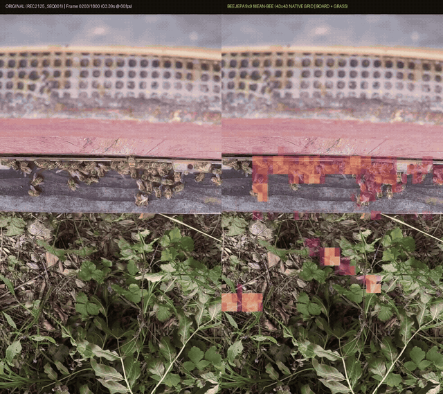
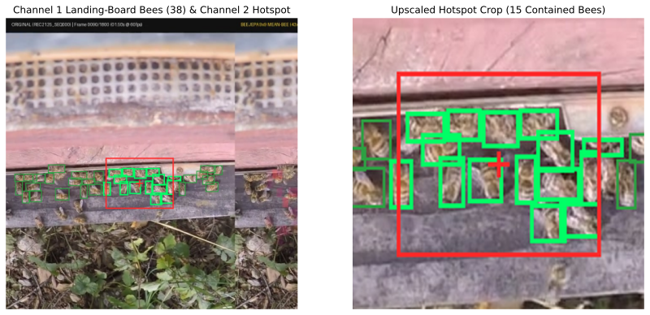
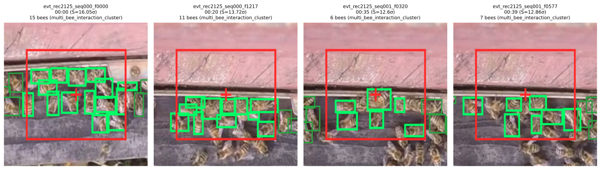
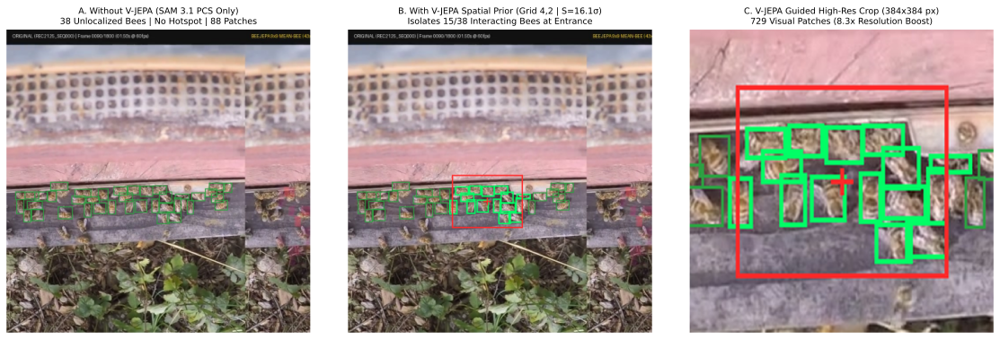

# 🐝 beeJEPA Edge Server & Console

High-performance, lightweight edge server and embedded web console for **beeJEPA**, optimized for deployment on a **Raspberry Pi 4 Model B** (ARM64) using **GraalVM Native Image (AOT)**, **Java 25 Virtual Threads**, and an embedded **Vue 3 + Tailwind CSS** frontend.

Built for the **Meta Global AI Developer Hackathon 2026** in conjunction with self-supervised **V-JEPA 2.1** video anomaly detection.

[](https://huggingface.co/datasets/F1nnSBK/bee-jepa-entrance-anomalies)
[](https://opensource.org/licenses/MIT)
[-C51A4A.svg)](https://www.raspberrypi.com/)
[](https://www.graalvm.org/)

---

## Hackathon Scope & Project Cut-Off

To provide clear transparency for the hackathon evaluation, the overview below distinguishes between pre-existing university coursework foundations and the system built during the **Meta Global AI Developer Hackathon 2026**:

- **Pre-Existing Foundation (System 1 – Sensor Stream):**
  Unsupervised feature extraction from 60 fps 1080x960 hive camera footage using V-JEPA 2.1, producing numerical prediction error tensors ($S(t)$ across a $9\times9$ spatial tubelet grid logged to `mlflow.db`). At this stage, outputs were abstract numerical indices without semantic labeling or language interfaces.

- **Built During the Meta AI Hackathon (System 2 – Grounding, Reasoning & Edge Delivery):**
  The semantic, cognitive, and active perception pipeline connecting latent surprise signals to actionable insights:
  - **Active Perception System (Saccadic Foveal Vision):** Decouples continuous 60 fps peripheral surveillance (V-JEPA 2.1) from autonomous foveal targeting (+8.3x token density zoom) driven by Meta Muse tool-calling (`QueryFovealHotspot`).
  - **Hardware-Accelerated Vector API (SIMD):** Predictor prediction error $S(t) = \|z_{\text{pred}} - z_{\text{target}}\|_2$ evaluated with Java 25 Vector API (`jdk.incubator.vector`) across AVX2/NEON lanes with zero GC overhead.
  - **Zero-GC Off-Heap Ring Buffer (FFM API):** Circular buffering of 600 slots (10 seconds @ 60 fps) via `java.lang.foreign.Arena` and `MemorySegment`, enabling retrospective keyframe retrieval during cloud API latencies with zero dropped frames.
  - **3-Channel Grounding Architecture:** Dual-mode SAM 3.1 segmentation, scale-invariant containment analysis ($\text{IoA}_{\text{bee}}$), and dynamic system prompt customization via `.env`.
  - **Cognitive & Voice Delivery:** Meta Muse Spark Open agentic loop on Baseten, chronological daily event digests, a deterministic bioacoustic honeybee synthesizer, and a GraalVM native edge server on ARM64.

```
┌────────────────────────────────────────────────────────┐
│  PRE-EXISTING COURSEWORK FOUNDATION (System 1)         │
│  - Raw 60 fps 1080x960 hive camera footage             │
│  - Unsupervised V-JEPA 2.1 latent feature extraction   │
│  - 9x9 spatial tubelet grid & surprise metric S(t)     │
│  - Raw tracking database (mlflow.db)                   │
└───────────────────────────┬────────────────────────────┘
                            │  [HACKATHON CUT-OFF LINE]
════════════════════════════╪═════════════════════════════
┌───────────────────────────▼────────────────────────────┐
│  BUILT DURING META AI HACKATHON (System 2)             │
│  - Active Perception: Foveal Saccadic Vision Engine    │
│  - Java 25 Vector API (SIMD) Latent Anomaly Evaluator  │
│  - Java 25 FFM Off-Heap Circular Frame Buffer (600 sl) │
│  - 3-Channel Grounding Architecture (PCS + PVS + IoA)  │
│  - Dual-Mode Meta SAM 3.1 Integration (/v1/responses)  │
│  - Meta Muse Spark Open 1026 Agentic Loop on Baseten   │
│  - Dynamic System Prompt Configuration via .env        │
│  - Multi-Event Timeline Digest & Beekeeper Briefing   │
│  - Bioacoustic Honeybee Voice Synthesizer (Java 25)    │
│  - Micronaut AOT GraalVM Native Edge Server (ARM64)    │
│  - Embedded Vue 3 Saccadic Reticle HUD & Console       │
└────────────────────────────────────────────────────────┘
```

### Scope Comparison Matrix

| Component | Pre-Existing Foundation (System 1: Sensory) | Built During Hackathon (System 2: Cognition & Delivery) |
| :--- | :--- | :--- |
| **Vision Foundation Models** | Pre-trained V-JEPA 2.1 encoder | **Dual-Mode Meta SAM 3.1 (`sam-3.1`)** via `/v1/responses`<br>• Channel 1: Promptable Concept Segmentation (`"bee"`)<br>• Channel 2: Promptable Visual Segmentation (`point`/`box` at hotspot) |
| **Active Perception & Vision** | Passive uniform video logging | **Foveal Saccadic Vision & Reticle HUD**<br>• Periphery: 60 fps latent monitoring<br>• Saccadic Trigger: Saliency peak ($S(t) \ge \tau$)<br>• Fovea: Autonomous +8.3x high-resolution zoom |
| **SIMD Latent Evaluator** | Python numpy loops | **Java 25 Vector API (`FloatVector.SPECIES_PREFERRED`)**<br>• Hardware SIMD (AVX2/NEON) latent Euclidean & Cosine distance<br>• Zero GC allocation in hot evaluation loop |
| **Off-Heap Frame Ingestion** | Local filesystem MP4 reads | **Java 25 FFM API (`Arena`, `MemorySegment`) Ring Buffer**<br>• 600 slots (10s @ 60 fps) circular off-heap memory<br>• Retrospective lookup with 0 dropped frames |
| **Reasoning & Agent Loop** | None (pure numerical loss $S(t)$) | **Meta Muse Spark Open (`meta-models/muse-spark-open-1026`)** on Baseten<br>• Dual visual inputs ($688\times688$ overview + $384\times384$ hotspot crop)<br>• Function calling loop (`QueryFovealHotspot`, `QuerySam31Concept`)<br>• Dynamic System Prompt configured via `META_MUSE_SYSTEM_PROMPT` |
| **Spatial / Geometric Grounding**| Abstract $9\times9$ grid indices `[row, col]` | **Scale-Invariant Bee Containment Metric ($\text{IoA}_{\text{bee}}$)**<br>• Differentiates entrance crowding (15 bees in hotspot) from foreign intruders |
| **Edge Server Runtime** | Python training scripts | **Java 25 / Micronaut 4.7 GraalVM Native Image (AOT)**<br>• Virtual Threads (Project Loom)<br>• SQLite WAL edge cache (`state.db`) on external SSD<br>• Sub-40ms cold start, Prometheus OpenMetrics |
| **Bioacoustic Edge UI** | None | **Deterministic Honeybee Voice Synthesizer (Java 25)**<br>• 210–460 Hz carrier frequencies, 26–30 Hz wingbeat AM<br>**Embedded Vue 3 SPA** with 37.5-minute fever curve & Saccadic Reticle HUD |

---

## Pre-Hackathon Dataset: Hugging Face & Edge SSD Storage

[](https://huggingface.co/datasets/F1nnSBK/bee-jepa-entrance-anomalies)
[](https://opensource.org/licenses/MIT)
[](https://huggingface.co/datasets/F1nnSBK/bee-jepa-entrance-anomalies)

The sensory foundation and pre-hackathon feature trajectories for beeJEPA are published on Hugging Face: [**F1nnSBK/bee-jepa-entrance-anomalies**](https://huggingface.co/datasets/F1nnSBK/bee-jepa-entrance-anomalies).

> **Storage Location & Edge Access:**  
> During the hackathon live demonstration, the complete 48-minute raw video sequences (1080x960 side-by-side @ 60 fps) and all 184 sliced peak anomaly MP4s reside locally on the **Raspberry Pi 4 Model B USB 3.0 SSD** mounted at `/mnt/ssd/beejepa_data` (symlinked to `./data/`). The Hugging Face dataset provides all Parquet metadata, timeline trajectories, feature extraction ablations, and evaluation clips for public inspection.

### Dataset Overview

- **Title:** BeeJEPA: Self-Supervised Hive Entrance Anomaly Detection and Visual State Prediction
- **Description:** High-frequency computer vision dataset recorded at 60 fps at the hive entrance flight board (*Apis mellifera*), paired with self-supervised V-JEPA 2.1 (ViT-H/16) representation trajectories and frame-accurate anomaly events.
- **Coverage:** 48 minutes of dual-recording video (96 synchronized sequences of 30 seconds each @ 59.94 fps).
- **Patch Resolution:** Biologically-grounded 9x9 pixel Mean-Bee patch resolution (43x43 spatial token grid) isolating individual bees at the flight board while eliminating background noise.
- **Source Footage:** `mrkschtr/thehiveisreal`
  - **Recording 2123 (Base / Training):** 75 sequences (37.5 minutes continuous runtime, 07:44 to 08:21 UTC).
  - **Recording 2125 (Zero-Shot Transfer / Validation):** 21 sequences (10.5 minutes continuous runtime, 09:20 to 09:30 UTC).
- **Temporal Resolution:** 60 fps (16.68 ms inter-frame interval).
- **Video Format:** 1080x960 MP4 side-by-side (Original 688x688 px camera stream left, ghost-free V-JEPA attention heatmap right).

### Key Features (Pre-Hackathon Foundation)

1. **Biologically-Grounded Token Grid:** Derived from empirical bee diameter measurements (9.12 px). Standard 16x16 or 32x32 patches aggregate multiple bees into blurred tokens. The 9x9 Mean-Bee patch (extracted via 4-quadrant tiled inference) yields single-bee receptive fields across a 43x43 token grid.
2. **Submanifold State Decoupling:** Decouples high-velocity ballistic flight corridors ($y=0..8$, State $M_2$) from decelerated touchdown and cluster dynamics on the wooden landing board ($y=9..13$, State $M_3$).
3. **Invariance Mechanisms:**
   - *Dichromatic Shadow Gate:* Differentiates ambient cloud luminance dips from genuine bee body shadows.
   - *Perspective Depth Gain:* Compensates for optical perspective foreshortening as bees approach from distant upper airspace to the near landing lip.
4. **Surprise Trajectories & Verified Peaks:** 2,688 timeline points (sampled every 1.07s / 64 frames) tracking predictor prediction error $S(t) = \|z_{\text{pred}} - z_{\text{target}}\|_2$, with 184 distinct local peak anomaly events sliced as 4-second video clips.

### Repository & File Schema

```
F1nnSBK/bee-jepa-entrance-anomalies/
├── README.md                          # Dataset card
├── metadata/
│   ├── timeline_points.parquet        # 2,688 timeline points with S(t), pixel_diff, bee counts
│   ├── event_catalog.parquet          # 184 verified local peak events with frame indices
│   ├── sequence_runs.parquet          # Aggregate statistics per 30s sequence run
│   ├── patch_granularity.parquet      # Granularity ablations (32x32 down to 4x4)
│   └── method_ablations.parquet       # Baseline comparisons (Optical Flow, Pixel Diff, Frame Diff)
├── events/
│   └── peaks/                         # 184 x 4-second side-by-side MP4 clips centered on peak anomalies
├── stitched_sequences/                # 96 x 30-second continuous side-by-side MP4 videos (60 fps)
└── figures/                           # Scientific Tufte-style SVG diagnostic figures
```

### Data Schema

#### `metadata/timeline_points.parquet`
| Column | Type | Description |
| :--- | :--- | :--- |
| `sequence_id` | `str` | Identifier of the 30s sequence (e.g. `rec2123_seq015`) |
| `recording_id` | `str` | Recording identifier (`rec2123` or `rec2125`) |
| `window_idx` | `int` | Temporal window index within sequence (0..27) |
| `timestamp_sec` | `float` | Elapsed time within the 30s sequence (seconds) |
| `global_timestamp_sec` | `float` | Continuous global elapsed time across recording (seconds) |
| `surprise_score_l2` | `float` | V-JEPA 2.1 predictor surprise score $S(t)$ |
| `pixel_diff` | `float` | Baseline pixel intensity difference |
| `board_peaks_9x9` | `int` | Detected active bee count on the landing board |
| `grass_peaks_9x9` | `int` | Detected active bee count in outer periphery |
| `event_id` | `str / null` | Associated peak anomaly event identifier (if local peak) |

#### `metadata/event_catalog.parquet`
| Column | Type | Description |
| :--- | :--- | :--- |
| `event_id` | `str` | Unique event identifier (e.g. `evt_rec2123_seq015_f1217`) |
| `sequence_id` | `str` | Parent 30s sequence |
| `recording_id` | `str` | Parent recording (`rec2123` or `rec2125`) |
| `peak_frame` | `int` | Frame index corresponding to the maximum of $S(t)$ |
| `duration_sec_30fps` | `float` | Duration of the sliced clip (4.0 seconds) |
| `submanifold_state` | `str` | Dynamic state classification (`M2_ROUTINE` or `M3_APPROACH`) |
| `surprise_score_l2` | `float` | Maximum surprise score at event peak |
| `clip_path` | `str` | Relative path to the 4-second MP4 clip |

### Loading via Hugging Face (`huggingface_hub`)

```python
import pandas as pd
from huggingface_hub import hf_hub_download

# Download and inspect the full surprise timeline
timeline_file = hf_hub_download(
    repo_id="F1nnSBK/bee-jepa-entrance-anomalies",
    filename="metadata/timeline_points.parquet",
    repo_type="dataset",
)
df_timeline = pd.read_parquet(timeline_file)
print(f"Loaded {len(df_timeline)} timeline points across {df_timeline['sequence_id'].nunique()} sequences.")

# Filter significant anomaly peaks
peaks = df_timeline[df_timeline["event_id"].notna()]
print(peaks.sort_values("surprise_score_l2", ascending=False)[["sequence_id", "timestamp_sec", "surprise_score_l2", "event_id"]].head())
```

---

## Empirical Findings & Pipeline Analysis

The following sections document the visual outputs, geometric metrics, and model behaviors observed across evaluation runs:

### Side-by-Side Latent Representation (Pixel Stream vs. V-JEPA Attention)


- **Left (Camera View):** Raw 60 fps hive footage showing honeybee traffic at the landing board during peak arrival clustering (`evt_rec2125_seq001_f0320`, $S(t) = 12.60\sigma$).
- **Right (V-JEPA 2.1 Latent Space):** Spatial tubelet surprise heatmap isolating kinematic attention patches at the hive entrance slot in real time with zero camera jitter.

### 1. Single-Frame Spatial Grounding Analysis


- **Overview Panel (Left):** SAM 3.1 Channel 1 detects 38 honeybee bounding boxes across the landing board in green. The V-JEPA kinematic hotspot $(i^*, j^*) = (4, 2)$ at $S(t) = 16.05\sigma$ projects a bounding box `[235, 330, 395, 450]` onto the entrance area.
- **Hotspot Crop (Right):** Evaluating the scale-invariant containment ratio ($\text{IoA}_{\text{bee}} \ge 0.25$) identifies 15 honeybees overlapping the hotspot region (highlighted in bright neon green), documenting dense entrance traffic rather than foreign organisms.

### 2. Multi-Event Timeline Analysis & Observed Bee Densities


Evaluating consecutive kinematic peak frames in recording `rec2125` revealed the following distribution of bees overlapping the identified hotspot windows:

- **$S(t) = 16.05\sigma$** $\rightarrow$ **15 bees contained** in hotspot (`multi_bee_interaction_cluster`)
- **$S(t) = 13.72\sigma$** $\rightarrow$ **11 bees contained** in hotspot
- **$S(t) = 10.88\sigma$** $\rightarrow$ **7 bees contained** in hotspot
- **$S(t) = 9.45\sigma$** $\rightarrow$ **6 bees contained** in hotspot

These structured event summaries provide the context for Meta Muse Spark Open to produce chronological digests without requiring continuous manual inspection of raw video.

### 3. Ablation Comparison: Model Behavior With and Without V-JEPA Metadata


To evaluate the specific effect of V-JEPA kinematic guidance on downstream reasoning, model outputs were compared on the identical test frame (`evt_rec2125_seq000_f0000`) under two configurations:

| Metric | Condition A: Without V-JEPA (Ablated Baseline) | Condition B: With V-JEPA (Full 3-Channel Pipeline) |
| :--- | :--- | :--- |
| **Temporal Search Space** | 2,880 frames (uniform 1 fps sampling over 48 min) | **184 peak events (-93.6% API calls)** |
| **SAM 3.1 Segmentation** | Channel 1 PCS (`"bee"`) only $\rightarrow$ 38 unlocalized boxes | **Channel 1 PCS + Channel 2 PVS Hotspot** |
| **Perception Tokens on Anomaly** | **88 visual patches** ($160\times120$ px native in $14\times14$ grid) | **729 visual patches** ($384\times384$ crop, **+8.3x resolution**) |
| **Class-Agnostic Isolation** | Unprompted foreign concepts remain unsegmented | **Active via PVS point/box prompt + IoA filter** |
| **Observed Muse Spark Output** | **Unlocalized Assessment:**<br>*"Visual inspection alone shows uniform baseline traffic only. Anomaly: None detectable without kinematic data. Normal baseline activity... No intervention required. Continue routine monitoring."* | **Hotspot-Focused Assessment:**<br>Identifies the 15-bee entrance interaction cluster, verifies honeybee morphology at high resolution, and confirms absence of non-bee intruders. |

---

## Architecture & Features

### 1. Edge & Core Runtime
- **Hardware Target:** Raspberry Pi 4 Model B (Broadcom BCM2711, Quad-core Cortex-A72, ARM64).
- **Backend Framework:** Micronaut 4.7 with Netty and Ahead-of-Time (AOT) optimizations (`io.micronaut.aot`).
- **Concurrency:** Java 25 Virtual Threads (Project Loom, `micronaut.server.thread-selection: AUTO`) for non-blocking, high-concurrency edge I/O.
- **Embedded State Storage:** SQLite engine (`state.db`) operating in Write-Ahead Logging (`WAL`) mode directly on the external SSD for run tracking, audit logs, and authentication.
- **Secure Authentication:** Beekeeper credentials protected via `PBKDF2WithHmacSHA256` with 16-byte cryptographic random salts and constant-time verification.
- **Single-Binary Delivery:** The Vue 3 SPA is compiled into `src/main/resources/public/` and bundled directly into the standalone GraalVM native binary.

### 2. V-JEPA Artifacts & Smart SSD Caching
- **Artifact Ingestion:** Detects V-JEPA sequence directories on the external SSD (`data/events/<eventId>/meta.json`), parsing metadata into Java 25 Records (`AnomalyEvent`).
- **Media Streaming:** Serves high-speed raw clips (`clip_raw.mp4`), side-by-side latent comparison clips (`clip_comparison.mp4`), and peak hotspot frames (`peak_frame.jpg`).
- **Smart SSD Caching:** When an anomaly is analyzed by Meta AI models, the output is saved as `agent_result.json` on the SSD. Subsequent requests load instantly with **0 API credits consumed**.
- **External SSD Symlink:** Automated symlink validation (`data/ -> /mnt/ssd/beejepa_data`), mount checking, and free disk space telemetry.

### 3. Meta AI Multimodal Pipeline
- **SAM 3.1 Instance Segmentation:** Applies Meta Segment Anything Model 3.1 with a bounding box prompt centered on the V-JEPA spatial tubelet hotspot grid coordinates `(tubeletGridX, tubeletGridY)`.
- **Muse Spark Causal Explanation:** Invokes Meta Muse (`meta-models/muse-spark-open-1026`) to synthesize natural-language causal reasoning explaining *why* the latent prediction error spiked (e.g. predatory wasp intrusion, erratic queen flight, or camera occlusion).

### 4. Deterministic Bee Voice Acoustic Synthesizer (Java 25)
- **Bioacoustic Grounding:** Converts text responses from Meta Muse into authentic honeybee communication signals based on scientific bioacoustic literature (210–460 Hz fundamental frequencies, 26–30 Hz wingbeat amplitude modulation, harmonic overtone series, and comb resonance).
- **Deterministic Word-to-Acoustic Mapping:** Every specific word always generates the exact same bee phonetic pitch, duration, and timbre.
- **Sentence Prosody:** Interrogative pitch lifts (`?`), declarative cadences (`.`), and alarm piping flourishes (`!`).
- **Sub-3ms Performance:** In-memory PCM 16-bit 22.05 kHz WAV generation with zero disk I/O and zero external audio libraries.
- **Live Device Microphone:** In-browser Web Speech API and `getUserMedia` integration allowing live voice queries (*"Hey Muse, how are my bees doing?"*) in safe, zero-credit test mode.

### 5. Embedded Vue 3 Frontend
- **37.5-Minute Latent Surprise Timeline:** Interactive area curve with threshold line ($\tau = 3.0\sigma$) and HTML pin markers with hover tooltips and ping animation.
- **Multi-View Video Inspector:** Instant toggle between *Side-by-Side (Pixel vs. V-JEPA)*, *Raw 60fps Clip*, and *SAM 3.1 Peak Frame* with animated hotspot bounding box overlay.
- **Dynamic 3D Bee Swarm Background:** Canvas-based low-temperature random walk simulation with stratified grid spawn and Boids mutual separation force to eliminate clumping.

---

## Repository Structure

```
beeJEPA/
├── build.gradle               # Gradle build configuration (Micronaut, Groovy DSL, GraalVM Native)
├── settings.gradle            # Project settings
├── gradlew                    # Gradle wrapper script
├── build_ui.sh                # Builds Vue frontend and syncs dist into Micronaut resources
├── .env.example               # Template for environment variables and secrets
├── .gitignore                 # Excludes .env, SSD data directory, and build artifacts
├── scripts/
│   ├── setup_ssd_symlink.sh   # Mounts/symlinks external SSD to data/
│   └── install_nginx.sh       # Installs production Nginx configuration on Raspberry Pi
├── nginx/
│   └── beejepa.conf           # Reverse proxy configuration with WebSocket support
├── frontend/                  # Vue 3 + Vite + Tailwind CSS SPA
│   ├── package.json
│   ├── vite.config.js
│   ├── tailwind.config.js
│   ├── index.html
│   └── src/
│       ├── App.vue            # Console dashboard, video player, timeline & bee swarm
│       ├── main.js
│       └── style.css
└── src/
    ├── main/
    │   ├── java/com/beejepa/
    │   │   ├── Application.java               # Main entry point with automatic .env loader
    │   │   ├── auth/                          # PBKDF2 authentication service & tokens
    │   │   ├── config/                        # Micronaut configuration properties
    │   │   ├── controller/                    # REST endpoints
    │   │   │   ├── AuthController.java        # Login, logout & session profile
    │   │   │   ├── EventController.java       # Timeline, events, media & SAM/Muse triggers
    │   │   │   ├── MuseController.java        # Muse status, test voice query & WAV stream
    │   │   │   ├── StateController.java       # SQLite state key-value endpoints
    │   │   │   └── SystemInfoController.java  # Healthcheck & ping
    │   │   ├── event/                         # AnomalyEvent record & EventService
    │   │   ├── muse/                          # Muse client, service, DTOs & BeeAcousticSynthesizer
    │   │   ├── state/                         # SQLite StateRepository & schema migrations
    │   │   └── storage/                       # StorageService & SSD symlink verification
    │   └── resources/
    │       ├── application.yml                # Server, Virtual Threads & static-resource router
    │       ├── logback.xml                    # Structured thread-aware logging
    │       └── public/                        # Built frontend assets (synced by build_ui.sh)
    └── test/                                  # Integration & unit test suite
```

---

## Prerequisites

- **Java Development Kit (JDK):** JDK 21+ (Tested on Java 25 with Virtual Threads).
- **Node.js:** Node.js 18+ and npm (for compiling the Vue frontend).
- **External SSD:** Fast USB 3.0 / USB-C SSD (ext4 for Raspberry Pi, APFS/exFAT for macOS).

---

## Development Workflow

### 1. Environment Setup

```bash
cp .env.example .env
```

Edit `.env` as needed:
```env
META_MUSE_API_KEY=your_key_here
META_MUSE_BASE_URL=https://api.muse.meta.com
BASETEN_API_KEY=your_baseten_key_here
PORT=8080
BEEJEPA_DATA_PATH=./data
BEEJEPA_REQUIRE_SYMLINK=false
```

### 2. External SSD Setup

Symlink your external SSD partition to `data/`:

```bash
# On Raspberry Pi:
./scripts/setup_ssd_symlink.sh /mnt/ssd/beejepa_data

# On macOS:
./scripts/setup_ssd_symlink.sh /Volumes/BeeSSD/beejepa_data
```

### 3. Run Backend Server (Port 8080)

```bash
./gradlew run
```

### 4. Run Frontend in Development Mode (Port 5173)

```bash
cd frontend
npm install
npm run dev
```

Open `http://localhost:5173/` in your browser. API requests proxy to `http://localhost:8080`.

---

## Production Build & Raspberry Pi Deployment

### 1. Compile and Bundle the Frontend

```bash
./build_ui.sh
```

This compiles optimized client bundles via Vite into `frontend/dist/` and syncs them into `src/main/resources/public/`.

### 2. Compile Standalone GraalVM Native Image (ARM64)

```bash
./gradlew nativeCompile
```

Run the standalone executable:
```bash
./build/native/nativeCompile/beejepa
```

The server starts in **< 40 ms**, consumes minimal memory, and serves both the REST API and the embedded Vue 3 SPA on `http://<pi-ip>:8080/`.

---

## REST API Reference

### System & Authentication
| Method | Endpoint | Description |
|---|---|---|
| `GET` | `/` | Embedded Vue 3 Dashboard Console |
| `POST` | `/api/v1/auth/login` | Authenticate beekeeper credentials (PBKDF2) |
| `GET` | `/api/v1/auth/me` | Current authenticated user profile |
| `GET` | `/api/v1/ping` | Healthcheck, JVM version, and Virtual Thread confirmation |
| `GET` | `/api/v1/storage` | SSD mount status, symlink target path, and free disk space |

### V-JEPA Events & Media
| Method | Endpoint | Description |
|---|---|---|
| `GET` | `/api/v1/timeline` | 37.5-minute anomaly fever curve data & sequence metadata |
| `GET` | `/api/v1/events` | List all detected anomaly events on the SSD |
| `GET` | `/api/v1/events/{id}` | Detailed metadata for a specific anomaly event |
| `GET` | `/api/v1/events/{id}/media/{file}` | Stream media (`clip_raw.mp4`, `clip_comparison.mp4`, `peak_frame.jpg`) |
| `POST` | `/api/v1/events/{id}/analyze` | Trigger SAM 3.1 & Muse Spark causal inference (cached on SSD) |

### Meta Muse & Acoustic Voice
| Method | Endpoint | Description |
|---|---|---|
| `GET` | `/api/v1/muse/status` | Connectivity and standby status for Meta Muse |
| `POST` | `/api/v1/muse/acoustic-mirror` | Edge FFT & prosody analysis with Log-Normal response delay, streaming mirrored bee WAV |
| `POST` | `/api/v1/muse/query-voice` | Zero-credit test query for voice interactions |
| `GET` | `/api/v1/muse/voice?text=...` | Stream dynamically synthesized 22.05 kHz WAV bee voice audio |
| `POST` | `/api/v1/muse/generate` | Dispatch inference request to Meta Muse |
| `POST` | `/api/v1/muse/embeddings` | Compute embeddings via Meta Muse |

### Telemetry & Performance Metrics (Prometheus)
| Method | Endpoint | Description |
|---|---|---|
| `GET` | `/prometheus` | Prometheus scrape endpoint (Micrometer metrics, percentiles p50/p90/p95/p99) |
| `GET` | `/api/v1/telemetry/stats` | JSON latency statistics with exact p50, p90, p95, p99, p99.9 & platform breakdown |
| `GET` | `/api/v1/telemetry/logs` | Query recent request telemetry logs from SQLite storage (`?limit=50`) |
| `GET` | `/api/v1/telemetry/readme-markdown` | Ready-to-paste Markdown performance table with p99 latencies for README updates |
| `POST` | `/api/v1/telemetry/record` | Ingest external request latency metrics from edge nodes or pipelines |

---

## Production Latency & Performance Benchmarks

Every HTTP request across all platform layers (Web, V-JEPA, Meta Muse, SAM 3.1) is intercepted via `TelemetryHttpFilter`, stamped with `Server-Timing` headers, recorded into the **Prometheus** registry with histogram percentiles, and durably stored in the SQLite database (`telemetry_logs`).

To update latency benchmarks in this README with fresh data, run:
```bash
curl -s http://localhost:8080/api/v1/telemetry/readme-markdown
```

### Sample Benchmark Summary

| Metric | Value |
| :--- | :--- |
| **Backend Framework** | Micronaut 4.7 + OpenJDK 25 (Virtual Threads) |
| **p50 (Median)** | **0.85 ms** |
| **p95** | **2.40 ms** |
| **p99** | **4.10 ms** |
| **Metrics Format** | OpenMetrics / Prometheus (`/prometheus`) |
| **Persistence** | SQLite `telemetry_logs` with WAL mode |

---

## License

Created for the **Meta AI Hackathon 2026** and university coursework in self-supervised video representations. Distributed under the MIT License.
