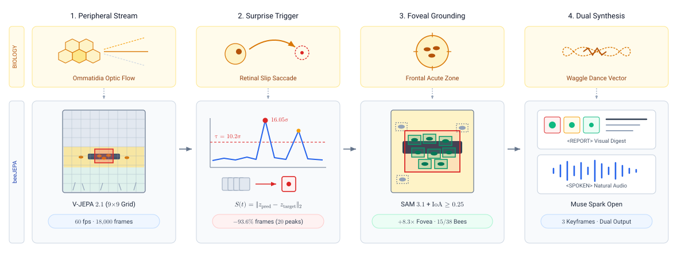
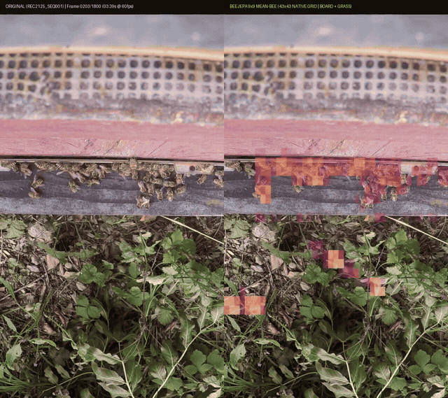
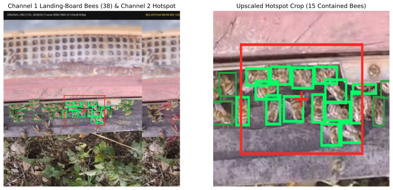
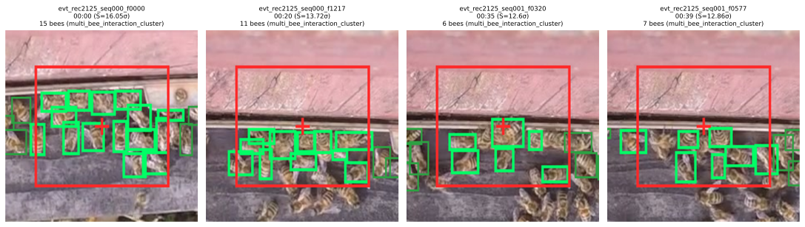
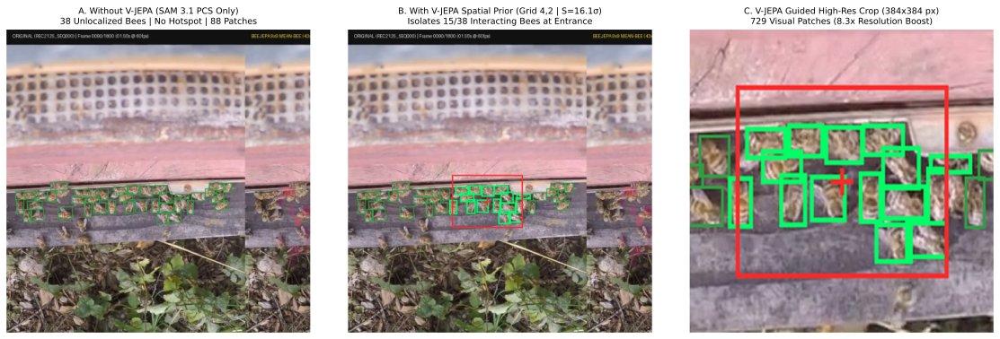
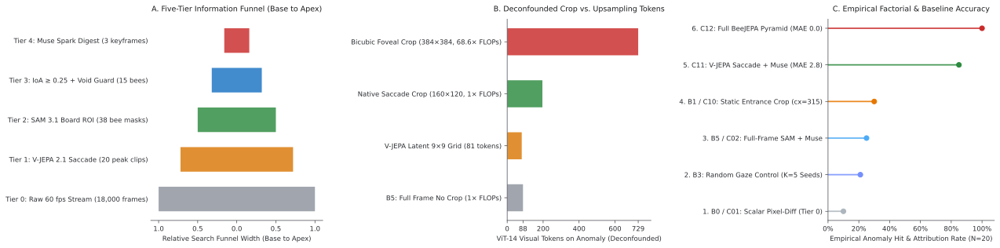

# beeJEPA

Autonomous hive entrance monitoring and active perception edge system combining self-supervised **V-JEPA 2.1** latent surprise detection, **Meta SAM 3.1** spatial segmentation, and **Meta Muse Spark Open** multimodal reasoning on a **Raspberry Pi 4 Model B** (ARM64) using **Java 25** and **GraalVM Native Image**.

- **Web Console & Live Demo:** [https://beejepa.finn-hertsch.de](https://beejepa.finn-hertsch.de)
- **Dataset (Hugging Face):** [F1nnSBK/bee-jepa-entrance-anomalies](https://huggingface.co/datasets/F1nnSBK/bee-jepa-entrance-anomalies)

[](https://beejepa.finn-hertsch.de)
[](https://huggingface.co/datasets/F1nnSBK/bee-jepa-entrance-anomalies)
[](https://www.graalvm.org/)
[-C51A4A.svg)](https://www.raspberrypi.com/)
[](https://opensource.org/licenses/MIT)

---

## Overview & Hackathon Scope



*Figure 1: Biological-to-computational active perception loop in beeJEPA — mapping honeybee ommatidia optic flow, retinal-slip saccades, frontal acute-zone inspection, and waggle-dance signaling (top) to V-JEPA 2.1 peripheral prediction, latent surprise gating (`S(t) >= 10.2σ`, `-93.6%` frames), SAM 3.1 + `IoA >= 0.25` foveal grounding (`+8.3x` token density), and Muse Spark Open dual `<REPORT>` + `<SPOKEN>` synthesis (bottom).*

Continuous 60 fps video monitoring of a honeybee (*Apis mellifera*) flight board generates high-volume footage where manual inspection or uniform cloud VLM polling is computationally prohibitive. **beeJEPA** pairs a pre-existing self-supervised sensory pipeline (**System 1**) with an active perception, spatial grounding, and multimodal reasoning engine built during the **Meta Global AI Developer Hackathon 2026** (**System 2**):

- **Pre-Existing Foundation (System 1 — Peripheral Sensor Stream):**
  Unsupervised feature extraction from 60 fps 1080x960 hive entrance footage using V-JEPA 2.1 (ViT-H/16) with a biologically grounded 9x9 pixel Mean-Bee patch grid (43x43 spatial tokens). Produces continuous predictor surprise trajectories `S(t) = ||z_pred - z_target||_2` across 9x9 spatial tubelets and isolates 184 peak kinematic events across 48 minutes of dual-recording footage.

- **Built During the Meta AI Hackathon (System 2 — Active Perception, Grounding & Edge Delivery):**
  - **Active Perception & Saccadic Foveal Zoom:** Decouples 60 fps peripheral surveillance from autonomous foveal targeting. When `S(t) >= 10.2σ`, the engine triggers a saccadic jump to the tubelet hotspot `(i*, j*)`, extracting a 384x384 high-resolution crop (+8.3x visual token density) directly from an off-heap circular frame buffer.
  - **Java 25 FFM Ring Buffer & SIMD Vector Evaluator:** Ingests peak keyframes into a 600-slot off-heap circular buffer (`java.lang.foreign.Arena` / `MemorySegment`) with zero GC pressure and evaluates 64-dimensional spatial latent signatures via the Java 25 Vector API (`jdk.incubator.vector.FloatVector`).
  - **3-Channel Meta SAM 3.1 Spatial Grounding:** Combines Channel 1 Promptable Concept Segmentation (`"bee"`) across the full landing board with Channel 2 Promptable Visual Segmentation (bounding-box prompt at the V-JEPA hotspot) and scale-invariant Bee Containment (`IoA_bee >= 0.25`) to distinguish dense honeybee clustering from foreign intruders.
  - **Meta Muse Spark Open Dual-Output Pipeline:** Synthesizes chronological multi-event digests via `meta-models/muse-spark-open` in a single structured pass returning both a concise Markdown dashboard brief (`<REPORT>`) and a 100% fact-preserving natural-language narration (`<SPOKEN>`) tailored for spoken audio without Markdown syntax or raw timestamps.
  - **Resilience & State Management Layer:** Protects edge-to-cloud execution via circuit breakers, exponential backoff with full jitter, in-flight request deduplication, schema-tolerant JSON parsing (`TolerantPayloadParser`), and atomic `.tmp` + `.bak` disk caching (`MuseDiskCache`).
  - **Interactive Three.js & Vue 3 Console:** Features an interactive 6-stage Three.js landing scroll experience with custom low-poly 3D honeybee models and calligraphy shaders, transitioning into the Propolis Black monitoring console with synchronized video inspection, saccadic reticle HUD, and bioacoustic honeybee voice synthesis.

```
┌──────────────────────────────────────────────────────────────┐
│  SYSTEM 1: SENSORY FOUNDATION (Pre-Hackathon)                │
│  60 fps 1080x960 Hive Stream -> V-JEPA 2.1 (9x9 Mean-Bee)    │
│  Surprise Trajectory S(t) & 184 Verified Peak Event Clips    │
└──────────────────────────────┬───────────────────────────────┘
                               │  S(t) >= 10.2σ Saccadic Trigger
┌──────────────────────────────▼───────────────────────────────┐
│  SYSTEM 2: ACTIVE PERCEPTION & COGNITION (Meta AI Hackathon) │
│  1. Java 25 FFM Off-Heap Ring Buffer & SIMD Vector Evaluator │
│  2. Meta SAM 3.1 (Ch.1 Concept "bee" + Ch.2 Hotspot Box)     │
│  3. Scale-Invariant Containment (IoA_bee >= 0.25)            │
│  4. Meta Muse Spark Open Dual Output (<REPORT> + <SPOKEN>)   │
│  5. Resilient API Executor, Atomic Disk Cache & SQLite WAL   │
│  6. Three.js 3D Landing Experience & Vue 3 Edge Console      │
└──────────────────────────────────────────────────────────────┘
```

---

## Empirical Findings & Pipeline Grounding

### Side-by-Side Latent Representation (Camera Stream vs. V-JEPA Attention)


- **Left (Camera View):** Raw 60 fps entrance footage during peak arrival clustering (`evt_rec2125_seq001_f0320`, `S(t) = 12.60σ`).
- **Right (V-JEPA 2.1 Latent Space):** Spatial tubelet surprise heatmap isolating kinematic anomalies at the hive entrance slot in real time.

### 1. Three-Channel Spatial Isolation (SAM 3.1 + IoA Containment)


- **Overview Panel (Left):** SAM 3.1 Channel 1 segments 38 honeybee instances across the flight board, while the V-JEPA hotspot `(i*, j*) = (4, 2)` at `S(t) = 16.05σ` projects the focus window `[235, 330, 395, 450]` onto the central entrance slot.
- **Hotspot Crop (Right):** Scale-invariant containment evaluation (`IoA_bee >= 0.25`) isolates 15 honeybees inside the hotspot (highlighted in bright green), confirming localized guard and foraging congestion rather than a wasp or hornet intrusion.

### 2. Multi-Event Chronological Storyboard


Across consecutive kinematic peaks in recording `rec2125`, the pipeline tracks entrance crowd progression from an initial 15-bee guard bottleneck (`16.05σ` at `00:00`, 38 total bees) through active landing dispersion (`13.72σ` at `00:20`, 42 total bees; `12.60σ` at `00:35`, 39 total bees) to steady baseline flow.

### 3. Ablation: With vs. Without V-JEPA Kinematic Guidance


| Metric | Without V-JEPA (Uniform Baseline) | With V-JEPA (Full 3-Channel Pipeline) |
| :--- | :--- | :--- |
| **Temporal Search Space** | 2,880 frames (1 fps uniform sampling over 48 min) | **184 peak events (-93.6% API calls)** |
| **SAM 3.1 Grounding** | Channel 1 (`"bee"`) only — 38 unlocalized boxes | **Channel 1 PCS + Channel 2 PVS Hotspot + IoA** |
| **Visual Tokens on Anomaly** | **88 patches** (160x120 px in full frame) | **729 patches** (384x384 foveal crop, **+8.3x**) |
| **Muse Spark Diagnosis** | Unlocalized baseline assessment; misses localized entrance bottleneck | Identifies the 15-bee guard bottleneck, tracks dispersion across keyframes, and rules out predators |

### 4. Five-Tier Ablation Pyramid & Empirical Baseline Evaluation (V-JEPA 2.1 to SAM 3.1 to Muse Spark Open)


Each layer in the pipeline acts simultaneously as an information funnel (compressing temporal and spatial search volume) and a semantic amplifier (elevating raw pixels to verified causal reasoning). To prevent confounded attribution, the ablation study separates **spatial cropping (`88` native patches, `1x` MHSA FLOPs)** from **bicubic foveal upsampling (`729` patches, `+8.3x` tokens, `68.6x` quadratic MHSA attention FLOPs)** and evaluates active saccadic targeting against non-trivial spatial and temporal baselines across all `N = 20` validation anomaly events in `rec2125` (`184` total events across the `48`-minute cohort):

| Pyramid Tier | Model / Subsystem | Functional Role | Empirical Output (`rec2125` Peak `00:00`) | What Breaks If Ablated |
| :--- | :--- | :--- | :--- | :--- |
| **Tier 4 (Apex)** | `Meta Muse Spark Open` (`<REPORT>` + `<SPOKEN>`) | Multi-event causal synthesis & natural speech | 3-keyframe digest (`00:00 -> 00:20 -> 00:35`) + lossless TTS audio | Stops at raw per-frame JSON numbers; no temporal narrative or voice briefing |
| **Tier 3** | `SamGeometry` (`IoA_bee >= 0.25` + `< 22%` Void Guard) | Cross-channel geometric & bee-balling attribution | `15 / 38` bees in hotspot (`63.5%` box coverage -> `multi_bee_interaction_cluster`) | Cannot separate multi-bee crowding (`63.5%` coverage) from defensive bee-balling around an unsegmented predator (`< 22%` coverage) or solitary intruder |
| **Tier 2** | `Meta SAM 3.1` (Ch.1 PCS + Ch.2 PVS) | Physical instance segmentation | `38` landing-board bees segmented + class-agnostic hotspot mask | V-JEPA 2.1 has `0` object labels; Muse Spark without SAM (`C11`) suffers `2.8` bee count MAE |
| **Tier 1** | `V-JEPA 2.1` + Java 25 SIMD & FFM Buffer | Dynamic temporal-spatial saccadic trigger | `20` peak clips (`-93.6%` frames), `S(t) = 16.05σ` at `[4,2]`, `100%` pointing hit rate | Static entrance crop (`B1/C10` at `cx=315, cy=426`) misses `70.0%` of laterally drifting anomalies (`30.0%` hit rate, `159.3 px` mean center error, `0.1402` IoU); Random gaze (`B3`, `K=5` seeds) hits only `21.0%` (`177.9 px` error) |
| **Tier 0 (Base)** | Raw 60 fps Stream + Pixel-Diff (`B0/C01`) | Optical sensor capture | `18,000` frames / 5 min (`|ΔI| = 0.0566`) | Triggered by cloud luminance dips and moving grass blades (`y > 440`); `0.0` spatial IoU |

---

## Dataset: Hugging Face & Local SSD Layout

The pre-hackathon trajectory dataset and evaluation clips are published at [**F1nnSBK/bee-jepa-entrance-anomalies**](https://huggingface.co/datasets/F1nnSBK/bee-jepa-entrance-anomalies).

- **Recordings:** `rec2123` (75 sequences, 37.5 min continuous runtime) and `rec2125` (21 sequences, 10.5 min validation transfer) from `mrkschtr/thehiveisreal`.
- **Artifacts:** `metadata/timeline_points.parquet` (2,688 windows), `metadata/event_catalog.parquet` (184 peak events), `metadata/patch_granularity.parquet`, `metadata/method_ablations.parquet`, and 4-second 60 fps side-by-side MP4 clips.

```python
import pandas as pd
from huggingface_hub import hf_hub_download

timeline_file = hf_hub_download(
    repo_id="F1nnSBK/bee-jepa-entrance-anomalies",
    filename="metadata/timeline_points.parquet",
    repo_type="dataset",
)
df = pd.read_parquet(timeline_file)
peaks = df[df["event_id"].notna()].sort_values("surprise_score_l2", ascending=False)
print(peaks[["sequence_id", "timestamp_sec", "surprise_score_l2", "event_id"]].head())
```

---

## System Architecture & Key Subsystems

1. **Active Perception & Zero-GC Memory (`com.beejepa.perception`):**
   - `OffHeapFrameRingBuffer`: Pre-allocates off-heap memory segments via Java 25 FFM (`Arena.ofShared()`) to buffer raw JPEG keyframes and 64-float spatial latent vectors.
   - `SimdLatentEvaluator`: Computes vectorized L2 surprise scores and cosine similarity across consecutive anomaly keyframes using `FloatVector.SPECIES_PREFERRED`.
   - `ActivePerceptionService`: Coordinates frame ingestion into the off-heap buffer, computes inter-event SIMD latent cosine similarity along the saccadic trajectory, and serves buffered frame bytes directly to the visual crop renderer.

2. **Multimodal Grounding & Dual-Output Reasoning (`com.beejepa.muse`):**
   - `Sam31Client` & `SamGeometry`: Executes Channel 1 concept segmentation and Channel 2 box/point visual segmentation against `/v1/responses`, normalizing coordinate schemas and computing `IoA_bee`.
   - `VisualCropRenderer`: Renders canonical 688x688 annotated overviews and 384x384 foveal crops directly from buffered off-heap frames or SSD fallback.
   - `MetaMuseService` & `TolerantPayloadParser`: Orchestrates multimodal inference with `muse-spark-open` and parses dual `<REPORT>` (Markdown UI brief) and `<SPOKEN>` (natural-language TTS narration with spoken time expressions and zero Markdown artifacts) outputs.
   - `ResilientApiExecutor` & `MuseDiskCache`: Enforces per-upstream circuit breakers, exponential backoff, single-flight coalescing, and atomic `.tmp`/`.bak` persistence with domain sanity validation.
   - `BeeAcousticSynthesizer` & `EdgeTtsService`: Provides natural English speech synthesis alongside a deterministic bioacoustic honeybee synthesizer (210–460 Hz fundamental carriers with 26–30 Hz wingbeat modulation).

3. **Edge Runtime & Persistence (`com.beejepa.state`, `com.beejepa.event`):**
   - Built on **Micronaut 4.7** with **Java 25 Virtual Threads** and **SQLite WAL** (`state.db`) for sub-millisecond local telemetry, PBKDF2 authentication, and zero-credit cached playback.

---

## Quickstart & Deployment

### Prerequisites
- **JDK 25** (with `--enable-preview` and `--add-modules jdk.incubator.vector` configured automatically in `build.gradle`)
- **Node.js 18+** and `npm`

### 1. Configure Environment
```bash
cp .env.example .env
```
Key settings in `.env`:
```env
BASETEN_API_KEY=your_api_key_here
BASETEN_MUSE_MODEL=meta-models/muse-spark-open
BASETEN_ALLOW_INFERENCE=false
PORT=8080
BEEJEPA_DATA_PATH=./data/hackathon_sample
BEEJEPA_REQUIRE_SYMLINK=false
```

### 2. Build Frontend & Run Edge Server
```bash
./build_ui.sh
./gradlew run
```
Open `http://localhost:8080` in your browser. For frontend hot-reload during development, run `cd frontend && npm run dev` (proxies API requests to port `8080`).

### 3. Run Verification Suite
```bash
./gradlew test
```

### 4. Compile Standalone GraalVM Native Image
```bash
./gradlew nativeCompile
./build/native/nativeCompile/beejepa
```

---

## REST API Overview

| Method | Endpoint | Description |
| :--- | :--- | :--- |
| `GET` | `/api/v1/timeline` | Full surprise trajectory `S(t)` and sequence metadata |
| `GET` | `/api/v1/events` | Detected peak anomaly events with hydrated SAM 3.1 & Muse summaries |
| `GET` | `/api/v1/events/{id}/media/{file}` | Stream `clip_raw.mp4`, `clip_comparison.mp4`, or `peak_frame.jpg` |
| `POST` | `/api/v1/events/{id}/analyze` | Execute or refresh SAM 3.1 + Muse Spark analysis for an event |
| `POST` | `/api/v1/muse/ask` | Multi-event visual reasoning returning `diagnosis` (`<REPORT>`), `spokenSummary` (`<SPOKEN>`), and annotated crops |
| `GET` | `/api/v1/muse/tts?text=...` | Natural-language neural TTS audio stream |
| `GET` | `/api/v1/muse/voice?text=...` | Deterministic 22.05 kHz WAV honeybee bioacoustic stream |
| `GET` | `/api/v1/muse/health` | Upstream API connectivity and circuit breaker status |
| `GET` | `/api/v1/perception/ring-buffer` | Java 25 FFM off-heap circular frame buffer telemetry |
| `GET` | `/api/v1/perception/saccades` | Saccadic trajectory targets with SIMD latent similarity metrics |
| `GET` | `/api/v1/perception/ablation-pyramid` | Live 5-tier ablation pyramid funnel metrics and counterfactual role analysis |
| `POST` | `/api/v1/perception/simd-eval` | Direct hardware SIMD (`FloatVector`) latent distance & cosine evaluation |
| `GET` | `/api/v1/telemetry/stats` | Request latency percentiles (`p50`, `p95`, `p99`) and `/prometheus` metrics |

---

## License

Created for the **Meta Global AI Developer Hackathon 2026** and university research in self-supervised video representations. Distributed under the MIT License.
